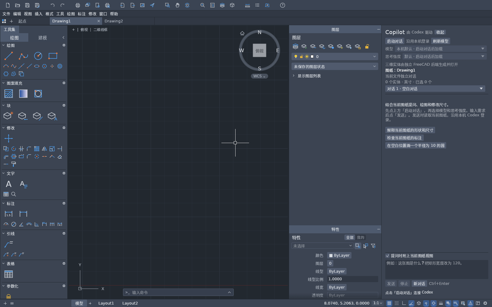
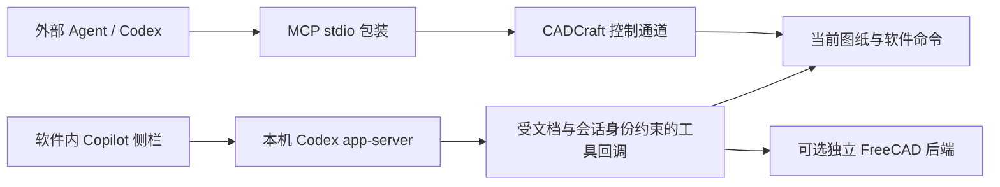

# ArtCraft AI Copilot

**为开源桌面应用接入 AI 助手：从 MCP 连接、Codex 插件封装，到软件内 Copilot 侧栏与文档独立多会话。**

本项目整理了一次可复现的 Linux 桌面集成实践。参考实现是 **CADCraft v0.7.0 + Codex app-server**：助手读取当前图纸的真实对象与视图，再通过软件自身命令执行绘图和修改。

这是独立的社区集成项目。当前提供 CADCraft 的源码补丁、构建/安装工具、MCP 插件模板、可复用 skill 和可选的 FreeCAD 进程桥接。**ArtCraft 主程序与其他桌面应用尚未在本项目中完成同等适配。** ArtCraft、CADCraft、Codex 和 FreeCAD 的名称归其各自项目所有。



*原验证环境的空白测试图纸；图中没有用户聊天或文档。*

## 已实现

- MCP 连接已有 CADCraft 桌面窗口；区分原始控制端口与真正的 MCP stdio 服务。
- 打包 Codex 插件：元数据、MCP 配置和软件操作 skill。
- 原生 Rust/egui 聊天侧栏，支持启动/自动连接、流式回复、停止、收起和重开。
- 从本机 Codex 加载模型、思考强度和图片能力；复用本机登录，包内没有账号或 API key。
- 每次发送读取当前图纸的对象、单位、选择和可选视图；修改后可读取实际结果。
- 新文件拥有独立对话；同文件可以新增多段会话，保留旧聊天并随时切回，草稿、模型设置和输出记录独立。
- 通过稳定文档 UID 管理运行状态；切换/停止时阻止旧请求继续绘图；已保存文件可恢复有界历史。
- 可选的独立 FreeCAD 后端生成轴承、长方体、圆柱和球体，导出 FCStd/STEP 并回读验证。
- 上游版本检查、独立合并、检查、构建校验、运行中拒绝安装、安装备份与回退流程。

当前 Linux 参考实现来自一次 0.5.0 → 0.7.0 的升级适配。中文输入还需操作系统提供可用的输入法；字体回退沿用新版 CADCraft。公开版继承用户的 Codex 审批策略，不强制切换成无限制策略。

## 架构



侧栏内部动态工具与外部 MCP 使用不同协议，但都落在目标软件的真实能力上。安装 MCP 插件不会自动给任意软件增加内嵌侧栏。

## 快速复现

需要 Git、Python 3.11+、Rust 1.95 工具链（包含 rustfmt、clippy 和 wasm32-unknown-unknown），以及 CADCraft 上游要求的 Linux 构建依赖。本项目不附带 CADCraft、Codex 或 FreeCAD 二进制。

```bash
python3 scripts/build_cadcraft.py prepare
python3 scripts/build_cadcraft.py verify
python3 scripts/install_local.py
```

第一步固定检出 CADCraft `v0.7.0` 的已审阅提交并应用补丁。第二步运行检查并构建 GUI/MCP CLI；不会安装。第三步只允许安装到一个新目录，拒绝覆盖已有安装。

默认安装后：

```bash
~/.local/share/artcraft-ai-copilot/launchers/artcraft-cadcraft
```

在本机安装并登录 Codex 后，点击侧栏「启动对话」，也可直接发送需求以自动连接。新安装有独立的应用身份；不会迁移你原有 CADCraft 的设置或聊天。

生成的绝对路径 MCP 配置位于：

```text
~/.local/share/artcraft-ai-copilot/plugin/.mcp.json
```

将它按目标 agent 的 MCP 格式注册，或按客户端当前支持的本地插件流程导入生成的插件目录。详见 [安装与连接](docs/INSTALL.md)。不要在服务器尚未连接当前窗口时省略 `--connect` 改用独立后台图纸。

## 目录

| 路径 | 内容 |
|---|---|
| `patches/` | 针对已固定上游提交的 CADCraft Copilot 源码补丁 |
| `scripts/` | 构建、安装、上游版本维护工具 |
| `plugins/cadcraft/` | 不含个人路径的 Codex 插件模板 |
| `skills/desktop-mcp-copilot/` | 可交给其他 agent 的完整集成 skill、检查/打包脚本 |
| `backends/freecad/` | 可选的独立进程建模桥接与显示宏 |
| `tests/` | 本仓库辅助工具的隔离测试 |
| `docs/` | 安装、设计、迁移、验证和能力边界 |
| `licenses/` | CADCraft 上游许可副本 |

## 验证与限制

源实现的 0.7.0 候选通过了 289 项 UI 测试、修改模块 Clippy、WebAssembly 检查及桌面构建，并实际验证了 MCP、模型目录、独立会话、切换与重开。公开版去除了机器路径，并调整了应用身份和审批策略；其检查结果记录在 [验证说明](docs/VALIDATION.md)。

目前的明确边界：

- 当前文档视图是发送时的采样，不是持续监视整个桌面。
- 普通 MCP 连接配置不会强制只读；按任务限制调用，并在客户端支持时配置工具 allowlist。
- 外部只读摘要接口未必返回稳定 UID，不能把标签索引当作稳定身份。内嵌会话池使用软件内部 UID。
- 其他 agent 的配置格式和工具重载方式需要分别验证。
- CADCraft 画布是二维平面视图；可选的三维实体在独立 FreeCAD 中显示，不能把三维多段线称作实体。
- 历史记录有数量/大小限制；重启后恢复本地记录不意味着旧服务进程或 thread 仍然运行。
- 上游发布可能产生源码冲突，自动合并无法保证所有未来版本都无需人工适配。

## 迁移与更新

[迁移指南](docs/PORTING.md) 说明如何为其他软件选择 API/SDK、建立命令桥接、增加侧栏并保持会话隔离。[版本维护](docs/UPDATING.md) 记录稳定版检查、补丁迁移、验证和回退流程。

本仓库不会自动创建 Codex 定时任务或系统定时器。需要提醒时，可让自己的 agent 定期运行生成的 `artcraft-cadcraft-update check`；仅在发现新版本时通知，安装仍由用户决定。

## 来源与许可

感谢 [ArtCraft](https://github.com/storytold/artcraft)、[CADCraft](https://github.com/storytold/cadcraft)、[Codex](https://github.com/openai/codex) 和 [FreeCAD](https://github.com/FreeCAD/FreeCAD)。本仓库新增的集成脚本、文档及独立桥接代码采用 MIT；CADCraft 补丁中沿用的上游代码保留其 MIT OR Apache-2.0 许可。没有重新打包外部 CAD 内核、商业软件、登录凭证或用户文档。详见 [第三方说明](THIRD_PARTY_NOTICES.md)。
